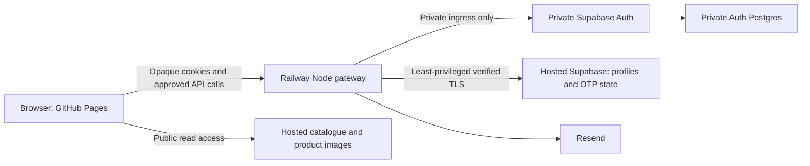

> Superseded on 11 October 2026 by [Supabase-only architecture](supabase-only-architecture.md). Retained as historical evidence; private Auth, Railway and gateway instructions are no longer an implementation plan.

# Selcore: mandatory email OTP production audit and implementation plan

Prepared 10 October 2026. Scope: Selcore at `ffznkypurnocabqyxpps`, repository revision `0416a9ebf33b771df61c2f91840b9bac5afad8bb`. This is an audit and proposed plan, not an activation instruction. Production was inspected read-only. No users were created, emails sent, credentials exported, migrations applied, deployments performed, commits made, or changes pushed. iVenue was not accessed.

**Decision:** the existing Railway wrapper cannot enforce all requested rules while public hosted Supabase Auth remains the customer credential authority. Recommend a private Supabase Auth service behind the existing Node gateway, with its own private Postgres database, while retaining hosted Supabase for catalogue, Storage and application data. This recommendation is conditional on the staging and migration gates below. The inactive prototype is useful preparation, but is not ready to activate.

**Confirmed user preference:** the 48-hour login exemption applies only to the same verified browser/device. The existing account-wide timestamp does not implement that preference.

This plan supersedes the account-wide exemption and production-cutover assumptions in [the earlier implementation record](email-otp-implementation.md). That record remains useful evidence of the inactive prototype, not authorization to activate it.

## 1. Evidence and boundaries

| Evidence                     | Verified in this audit                                                                                                                  | Limits                                                                                                          |
| ---------------------------- | --------------------------------------------------------------------------------------------------------------------------------------- | --------------------------------------------------------------------------------------------------------------- |
| Working tree                 | Initially clean, `main`, revision above                                                                                                 | No fetch, push or deployment in this task                                                                       |
| Local implementation         | Frontend service/adapter, backend modules, SQL draft, configuration, lockfile and existing documentation reviewed                       | Review does not establish live service compatibility                                                            |
| Public Selcore Auth settings | HTTP 200; email enabled; signup allowed; email autoconfirm false; Google, phone and anonymous sign-ins disabled                         | Public settings do not disclose SMTP, Site URL, redirect allowlist, hooks or password reauthentication settings |
| Remote migration ledger      | Three applied migrations, listed below                                                                                                  | No ledger changes                                                                                               |
| Remote schema metadata       | All five public tables have RLS enabled; profiles ownership and confirmed-email checks are present; no private `selcore_*` tables exist | No customer rows, password hashes or tokens retrieved                                                           |
| Security Advisor             | No critical findings; one existing warning: leaked-password protection disabled                                                         | Does not certify the proposed service or all Auth settings                                                      |
| Targeted automated tests     | 287 assertions passed, zero failed                                                                                                      | Auth/email responses are mocked; database tests are isolated                                                    |
| Dependencies                 | Backend production dependency audit: zero reported vulnerabilities                                                                      | Point-in-time advisory check, not a penetration test                                                            |

The profiles table has a cascading foreign key to hosted `auth.users(id)`. Its three authenticated SELECT/INSERT/UPDATE policies require ownership and `private.selcore_verified_customer()`. That helper checks a real, confirmed, non-anonymous hosted Auth user. It does not require OTP or check session revocation. RLS is enabled, but not forced on table owners; runtime roles must therefore neither own these tables nor have BYPASSRLS privileges.

The frontend contains a publishable key, which is intended for public use. Administrative credentials are not needed for these read-only probes. Full production Auth/SMTP configuration, Resend sender verification, Railway ingress settings, and the hosted GoTrue server version remain **unverified**. Resend is infrastructure reported by the user; successful live delivery was not tested.

## 2. Existing implementation and confirmed gaps

The existing website still uses SDK **2.110.7** directly for signup, password login, confirmation resend, recovery, password updates and Google OAuth. It uses PKCE, explicit callback processing, session persistence, verified-email profile access and account-specific cart/favorites storage. Password case is preserved. None of those flows was changed in this audit.

Three separate controls keep the OTP preparation inactive:

- `auth-gateway.js`: browser `enabled = false`.
- `server/otp/runtime.cjs`: source `serviceEnabled = false`; environment variables cannot enable it. Startup refuses before credential inspection, network connections or listening.
- `supabase/migrations/20261010110437_selcore_email_otp_security.sql`: unapplied draft, with enforcement defaulting to false.

The prototype already provides eight-digit cryptographic codes, HMAC code/action binding, encrypted server-held native tokens, database-clock expiry, attempt limits, shared resend reservations, opaque HttpOnly cookies, ownership checks and generic errors. These are useful controls, not substitutes for controlling every credential mutation path.

| Activation blocker or gap             | Local evidence                                                                                                          | Required correction before activation                                                                                       |
| ------------------------------------- | ----------------------------------------------------------------------------------------------------------------------- | --------------------------------------------------------------------------------------------------------------------------- |
| Account-wide login exemption          | `selcore_otp_logins` is keyed only by user; approval reads that account timestamp                                       | Replace with user plus verified device proof                                                                                |
| Hosted Auth schema dependency         | Draft foreign keys and live-session helper reference `auth.users` and `auth.sessions`                                   | Introduce application identities/sessions compatible with a separate private Auth database                                  |
| One origin used for Auth and profiles | `native.cjs` uses `createClient` for both Auth and `.from("profiles")`                                                  | Separate private Auth adapter from hosted application-data adapter                                                          |
| Standalone Auth URL contract          | SDK adapter assumes a full Supabase origin with `/auth/v1` and REST routes                                              | Test an official Auth client or a private path adapter; an Auth-only service has no PostgREST                               |
| Railway address rejection             | Private-origin validator accepts loopback/RFC1918 literal IPv4 but rejects private Railway DNS and IPv6 ULA             | Validate one approved internal service destination and its network isolation; retain redirect/credential-forwarding refusal |
| Frontend/API origin mismatch          | Adapter uses same-origin `/api/auth`; HTTP handler requires that exact Origin and has no CORS support                   | Choose and implement one approved routing/cookie arrangement                                                                |
| OAuth and old-link compatibility      | Gateway blocks Google; private callback flow is absent; legacy confirmation/recovery callbacks work only in legacy mode | Implement controlled OAuth and old-link transition handling before cutover                                                  |
| Session fixation hardening            | Guest handles are not consistently rotated at successful authentication                                                 | Rotate on login, verification and account transitions; invalidate old handles                                               |
| Refresh concurrency                   | Native refresh occurs before the stored revision comparison                                                             | Lock/serialize a session before refreshing, not just before saving its replacement tokens                                   |
| Proxy quotas                          | HTTP handler uses socket IP, ignoring forwarded headers                                                                 | Verify Railway's trusted proxy chain; accept only a documented, trusted source-IP signal                                    |
| Device trust revocation               | Existing account timestamp is not cleared by the user-wide approval revocation function                                 | Revoke device proofs on credential changes, recovery, global logout and compromise                                          |
| Native email proof ordering           | Current dual old/new `generateLink` handling is tested against fixtures                                                 | Prove issuance, resend, verification order and final mutation against the pinned real Auth service                          |
| Operations                            | No production cleanup, key rotation or approved readiness contract                                                      | Add retention, versioned keys, alerts, backups and safe readiness behavior                                                  |

An existing session cookie lasts up to seven days, but the draft profile approval is bounded by its verification timestamp plus 48 hours. That is stricter than a rule about subsequent logins alone. The plan below checks device trust on explicit login; active-session idle/absolute limits must be documented separately before activation. Refresh must never renew the device's verification timestamp.

## 3. Can hosted Supabase Auth enforce every rule?

**Finding:** not with the currently documented controls and this wrapper. This is a conclusion from current official documentation and upstream code review, not a destructive production exploit test.

Native password reauthentication exempts sessions created within the previous **24 hours**. Requiring the current password is a separate control and is not a fresh email OTP. Consequently, neither setting satisfies OTP before **every** password change. [Supabase password security](https://supabase.com/docs/guides/auth/password-security).

The documented Auth Hooks do not include a before-password-update hook. The password verification hook runs during password sign-in, not credential updates; it is listed for Teams/Enterprise. A send-email hook controls delivery, and a custom-token hook controls issuance claims, not all later Auth mutations. [Auth Hooks](https://supabase.com/docs/guides/auth/auth-hooks), [password verification hook](https://supabase.com/docs/guides/auth/auth-hooks/password-verification-hook), [send-email hook](https://supabase.com/docs/guides/auth/auth-hooks/send-email-hook).

Upstream `UserUpdate` currently checks the 24-hour reauthentication window, current-password options and enrolled MFA assurance. It does not consult Selcore's OTP approval tables. This corroborates the bypass risk, but the `master` source is not proof of the exact hosted server version. [Official Auth update implementation](https://raw.githubusercontent.com/supabase/auth/master/internal/api/user.go).

| Direct hosted path                          | What remains outside the wrapper                                | Consequence for the requested policy                                                                                                   |
| ------------------------------------------- | --------------------------------------------------------------- | -------------------------------------------------------------------------------------------------------------------------------------- |
| `/auth/v1/token?grant_type=password`        | Native password sign-in can issue native tokens                 | A pending gateway session is not a universal first-login/device OTP gate                                                               |
| `/auth/v1/token?grant_type=refresh_token`   | Existing native refresh tokens remain usable independently      | Browser adapter changes do not revoke legacy sessions                                                                                  |
| `/auth/v1/user` password update             | Native session/current-password/reauthentication rules apply    | Fresh sessions can avoid the proposed mandatory per-change OTP                                                                         |
| `/auth/v1/signup`, `/verify`, `/resend`     | Native registration and confirmation remain callable            | Native email confirmation can still establish ownership, but wrapper quotas and attempt limits do not automatically govern these paths |
| `/auth/v1/user` email update and `/verify`  | Native secure email-change rules apply                          | Old/new native confirmation can protect ownership, but wrapper-specific step-up, binding and limits are not automatically enforced     |
| `/recover`, `/otp`, `/verify`, OAuth routes | Alternate recovery/passwordless/provider sessions can be issued | Every enabled flow must participate in the approval policy                                                                             |

Native confirmation is not being declared bypassable when correctly enabled. The problem is enforcing the complete custom policy consistently across all entry points. The existing frontend already invokes several of these official endpoints. [Password authentication flows](https://supabase.com/docs/guides/auth/passwords), [email OTP/passwordless flows](https://supabase.com/docs/guides/auth/auth-email-passwordless).

Profile RLS can deny application data until approval, but cannot prevent Auth itself from changing a password. User-editable metadata, UI flags, CORS, a hidden publishable key, or placing a proxy in front of an unchanged public origin cannot close that gap. Supabase's documented network restrictions cover Postgres/pooler connections, explicitly excluding HTTPS APIs such as Auth. [Network restrictions](https://supabase.com/docs/guides/platform/network-restrictions).

Native MFA currently documents TOTP and phone factors. A reusable AAL2 session is not a new eight-digit email proof bound to each credential mutation. [Supabase MFA](https://supabase.com/docs/guides/auth/auth-mfa).

No production mutation requests were made to demonstrate these paths. Exact enabled hooks, secure-email-change settings and password settings still require an owner-reviewed configuration inventory.

## 4. Architecture comparison and recommendation

| Architecture                                            | Complete policy?                                                 | Practical tradeoff                                                                                                                                 |
| ------------------------------------------------------- | ---------------------------------------------------------------- | -------------------------------------------------------------------------------------------------------------------------------------------------- |
| Hosted Auth plus frontend OTP                           | No                                                               | Client controls are bypassable                                                                                                                     |
| Hosted Auth plus Railway wrapper, hooks and profile RLS | No, with documented current controls                             | Useful application-data protection, but no mandatory gate for every Auth password update                                                           |
| Managed external identity provider                      | Conditional                                                      | Potentially less operational work; must demonstrate exact eight-digit email OTP, device timing, recovery and mutation enforcement before selection |
| Private Supabase Auth behind Railway gateway            | Yes, if all customer credential routes are controlled and tested | Reuses current Auth contracts; adds private Auth and its durable database, with security updates/backups owned by Selcore                          |
| Mature authentication library embedded in Node          | Conditional                                                      | Fewer service processes, but greater rewrite and credential-management responsibility; do not invent a password engine                             |

The recommendation is the private Auth option, because it preserves the most existing integration while creating the missing enforcement boundary. Initially it needs no full self-hosted Supabase stack, separate PostgREST, Redis or message broker. Postgres can handle durable quotas, locks and an outbox. Self-hosting requires an owner for security updates and tested backups; Supabase explicitly documents those responsibilities. [Official Auth self-hosting guidance](https://github.com/supabase/auth#running-in-production).

The browser receives no native Auth access/refresh/admin tokens. Only the gateway can access the private credential service. Do not expose a generic Auth proxy, private Auth domain, or public database TCP proxy. A narrowly validated OAuth callback may be public through the gateway; that does not authorize arbitrary native Auth routes.

Hosted Supabase remains the application-data and Storage platform, **not the active customer credential authority** after cutover. Supabase documents that its Auth service cannot currently be disabled completely. Therefore cutover must remove old customer identity eligibility and protected-data access, rather than assume a provider toggle makes the original API disappear. A third-party integration alone also does not remove hosted Auth. [Third-party Auth limitations](https://supabase.com/docs/guides/auth/third-party/overview).

Prefer gateway access to profiles through a dedicated least-privileged database role. Do not routinely use hosted `service_role` for customer profile requests or share hosted signing secrets with the private issuer. Public catalogue/image access stays as it is. Direct third-party JWT access is an optional later design requiring a supported, tested issuer integration; it is not a prerequisite for this recommendation.

## 5. Required policy and server state

All challenge purposes use exactly eight ASCII digits, retaining leading zeros. The authoritative expiry is database time plus ten minutes. Allow at most five code-comparison submissions; after five failures, deny even a correct code. A correct fifth submission may succeed. Resending is forbidden before 60 seconds, cancels the previous proof and never extends its original validity. Browser timers are informational.

Keep shared account/purpose quotas across browsers and replicas; a new device must not reset resend or abuse counters. Retain the draft's additional issuance and IP/session limits, with staging validation and a global delivery circuit breaker. Malformed requests still count toward transport/abuse limits. Reserve capacity before native generation or SMTP so concurrent losers cannot invalidate the winning native proof.

Store HMAC digests, not plaintext codes. Bind every proof to subject, purpose, pending operation, session/device context and target email where applicable. Password actions must bind the exact proposed password without storing it; never lowercase, uppercase, trim or otherwise normalize passwords. Apply one explicit server email canonicalization policy compatible with the identity engine; do not rewrite provider-specific dots or plus suffixes.

| Flow                                                           | Mandatory proof and completion rule                                                                                                                   |
| -------------------------------------------------------------- | ----------------------------------------------------------------------------------------------------------------------------------------------------- |
| Registration                                                   | Registration-purpose OTP confirms the pending identity; no protected profile access before verification; duplicate responses remain generic           |
| First explicit login                                           | Password/OAuth authentication plus fresh login-purpose OTP; registration verification does not create a login exemption                               |
| Subsequent login                                               | Exemption only for this user and this valid device proof, with last login OTP less than 48 hours old; otherwise OTP                                   |
| Password change, including first password for an OAuth account | Newly issued, one-use password proof bound to the proposed change; no recent-login exemption                                                          |
| Password recovery                                              | Recovery OTP grants only a short-lived, one-use password-reset operation; no normal profile session or automatic login                                |
| Email change                                                   | Fresh operation-bound proofs to current and proposed addresses; update only after both succeed; an expired/failed proof leaves the current address    |
| Google login                                                   | Successful provider callback remains pending until the same first-login/device OTP rules pass; provider email verification does not waive Selcore OTP |

The dual-address email requirement is a proposed protective implementation of mandatory email-change OTP. Prove native dual-token ordering first. If native semantics cannot preserve both proofs, collect both gateway-controlled OTP proofs and perform one private administrative mutation only afterwards. Do not deploy an untested mix of native and gateway confirmation rules. Native `generateLink` supports server-generated email proofs, but fixture success is insufficient. [Official generateLink API](https://supabase.com/docs/reference/javascript/auth-admin-generatelink).

### Device exemption

Add a separate opaque, host-only, Secure, HttpOnly device-proof cookie. Store only its digest with user ID, `last_login_otp_verified_at`, expiry and revocation state. It is a browser-held proof, not hardware attestation; do not rely on user agent, IP fingerprints, localStorage timestamps or user metadata.

Only a completed **login OTP** sets that device's clock. A different browser, missing/invalid cookie, another account, or time at/after 48 hours requires OTP. Password, registration and email proofs do not silently advance it. Native session refresh does not advance it either. A stolen password alone cannot use another browser's exemption.

Rotate authentication handles at every successful authentication/account transition. Normal local logout clears the session; the separate device exemption may remain until its original deadline. Global logout, password/recovery/email changes and compromise response revoke every device proof and approval. Treat stolen device cookies as compromised credentials; this exemption is not an additional hardware factor.

Use an independent, explicit server session idle/absolute lifetime policy. The user specified a login exemption, not mandatory interruption of an already active session at exactly 48 hours. Final session lifetimes and registration auto-login behavior are product decisions to approve before cutover; they must never permit unverified initial login or waive a credential-change proof.

## 6. Database and migration history

Fresh remote history and corresponding local files:

| Migration    | Production                                            | Local                                           | Action proposed                                                         |
| ------------ | ----------------------------------------------------- | ----------------------------------------------- | ----------------------------------------------------------------------- |
| Catalogue    | `20261008124517_create_selcore_catalog_phase1`        | Same version/name                               | Preserve                                                                |
| Image bucket | `20261008125807_create_product_images_storage_bucket` | Same version/name                               | Preserve                                                                |
| Profiles     | `20261009140454_selcore_customer_profiles`            | `20261008000000_selcore_customer_profiles.sql`  | Reconcile local historical filename/snapshot after exact content review |
| OTP          | Absent                                                | `20261010110437_selcore_email_otp_security.sql` | Keep unapplied; redesign before considering deployment                  |

The local profiles draft and existing deployed SQL snapshot differ only in comments/blank lines in the local comparison. Live profile/helper/policy metadata matches that design. This is not a fresh byte-for-byte comparison of the complete remote ledger SQL against the snapshot; perform that final provenance check before reconciling files.

Safe procedure: obtain the already-applied profiles definition through an owner-approved read-only export; compare it and dependencies with the local snapshot; align the local historical file to the **already-applied** version. Keep an exact archived snapshot if comments differ. Do not execute its SQL again, repair the remote ledger automatically, or blindly run `db push`. If actual schema differences exist, address only those with a separately reviewed additive migration. Quarantine the pending OTP draft from any automatic migration job until redesigned.

The existing draft cannot be used unchanged with a separate Auth database. New application-owned identity records should preserve current UUIDs and link to the private issuer. Migrate the profiles foreign key to that application-owned identity parent with staged backfill and validation; preserve all profile rows. Never delete hosted users while the current cascading foreign key is in place.

Keep native credential tables solely in the private Auth database, managed by that Auth engine. Do not point a second GoTrue writer at the hosted managed `auth` schema. Replace cross-database `auth.sessions` foreign keys with application session/approval records, validated private issuer/subject/session information, and explicit revocation. An application row must not falsely claim that a hosted session and private session are the same object.

Proposed application migrations, generated only in a future approved implementation: identity mapping/backfill; device proofs; application approvals and encrypted sessions; revised challenge/quota functions; profile ownership access for the gateway; removal of legacy protected-data grants at cutover. Keep each purpose separately reviewable. Use RLS, non-owning NOBYPASSRLS runtime roles, parameterized queries, both UPDATE ownership predicates, restricted function execution and safe search paths. Do not accept a request-supplied user ID as authorization context.

At cutover, revoke `anon`/`authenticated` direct access to protected profiles and inspect related views/RPCs/GraphQL paths. Expose profiles only through the approved gateway role and ownership/session checks. Old hosted JWTs must fail those paths even before their expiry. Keep catalogue and image grants untouched.

The deployed profiles snapshot also includes `selcore_create_profile`, an AFTER INSERT trigger on hosted `auth.users`. Replace that application integration with idempotent private-identity/profile creation; retire the old trigger and old authorization-helper dependency in the approved cutover migration, while preserving profile rows and their timestamp trigger. Inventory live dependencies before changing them.

Separately approved hosted Auth cutover changes include disabling legacy customer signup/providers, revoking refresh sessions and deactivating migrated legacy identities. Test the actual effect of each control; do not claim these disable the whole hosted Auth API. The essential guarantee is that legacy identities/tokens can no longer authorize Selcore application access or alter its active private credentials.

Current Supabase changelog notes an October 30, 2026 rollout changing default exposure of new public tables. Define intended grants explicitly; keep OTP/identity state private. Existing catalogue grants are not a reason to grant new private tables to customers. [Data API exposure change](https://supabase.com/changelog/45329-breaking-change-tables-not-exposed-to-data-and-graphql-api-automatically).

## 7. Railway, browser routing and Resend prerequisites

Railway's backend root should remain `/server/otp`; the tracked package/lockfile, Node entry `serve.cjs`, `npm start` and Node-provider `railpack.json` are present. Use Railpack, deterministic lockfile installation, a pinned supported Node release satisfying `>=22`, and Railway's `PORT`. The prepared runtime selects `0.0.0.0` when `PORT` is present. A successful image build is not readiness: the current source guard must keep refusing startup.

Private Auth and its Postgres must have durable backups and no public ingress. Railway uses internal DNS and private IPv6/IPv4 addressing; the current literal-address validator requires a future reviewed compatibility change. Verify exact destination DNS, bind behavior, TLS/authentication requirements and access from outside the private environment. Do not replace the validator with unrestricted host acceptance. [Railway private networking](https://docs.railway.com/networking/private-networking).

GitHub Pages cannot run the Node `/api/auth` routes. Choose one of these arrangements before activation:

- **Recommended while retaining Pages:** one owned domain with Pages and the Railway API on separate HTTPS subdomains of the same site. Change the adapter to the exact API origin with credentialed requests; implement a single explicit CORS allowlist, preflight handling and strict Origin/CSRF validation. Keep host-only API cookies.
- **Alternative:** an approved reverse proxy serves frontend and API under one origin. This retains the current adapter contract, but introduces another routing component.

An unrelated `github.io` origin and Railway domain are cross-site; the existing Strict cookie cannot simply be reused there. Do not solve this by blindly weakening cookies or enabling wildcard credentialed CORS. Same-site subdomains still differ in origin and need explicit credentialed CORS. [Browser CORS rules](https://developer.mozilla.org/en-US/docs/Web/HTTP/Guides/CORS), [cookie attributes](https://developer.mozilla.org/en-US/docs/Web/HTTP/Reference/Headers/Set-Cookie).

Keep Auth tokens in encrypted server storage and user authentication cookies Strict where possible. OAuth callbacks need a dedicated short-lived state/PKCE correlation mechanism compatible with a cross-site return, such as a separate narrowly scoped Lax transaction cookie. Do not make the general authentication cookie unrestricted. Validate callback Origin/redirect/state, consume state once, and never return provider/native tokens to browser URLs or logs.

Resend transport exists locally but live configuration is unverified. Use server-only scoped sending credentials, a verified sender domain, SPF/DKIM checks and monitored delivery limits. The current adapter supports TLS SMTP on 465 or required STARTTLS on 587. Only one component should send each OTP. Never run both native automatic delivery and gateway delivery for the same operation. [Resend SMTP](https://resend.com/docs/send-with-smtp), [domain verification](https://resend.com/docs/dashboard/domains/introduction).

Use a database-backed delivery reservation/outbox with encrypted short-lived payload if retries require the code. Do not regenerate codes on retry or store plaintext code in a durable queue. Prevent delayed/out-of-order mail from authorizing a canceled challenge. Track delivery/bounce outcomes and signed webhook events without OTPs, password bodies, tokens or unnecessary recipient data. [Resend webhooks](https://resend.com/docs/webhooks/introduction).

### Configuration names and ownership

Existing gateway environment names, with **no secret values**:

| Component            | Names                                                                                             | Required handling                                                                                                         |
| -------------------- | ------------------------------------------------------------------------------------------------- | ------------------------------------------------------------------------------------------------------------------------- |
| Private Auth adapter | `SELCORE_PRIVATE_SUPABASE_ORIGIN`, `SELCORE_PRIVATE_PUBLISHABLE_KEY`, `SELCORE_PRIVATE_ADMIN_KEY` | Credentials for the private engine only; verify SDK/admin authentication contract; never reuse hosted administrative keys |
| Application database | `SELCORE_OTP_DATABASE_URL`                                                                        | Dedicated runtime login, verified TLS, no owner/superuser/BYPASSRLS                                                       |
| Cryptography         | `SELCORE_OTP_HMAC_KEY`, `SELCORE_OTP_ENCRYPTION_KEY`                                              | Independent random keys; HMAC at least 32 bytes, AES key exactly 32 bytes; add key IDs and rotation support               |
| Email                | `SELCORE_SMTP_USER`, `SELCORE_SMTP_PASSWORD`, `SELCORE_SMTP_FROM`, `SELCORE_SMTP_PORT`            | Protected Resend credential and approved sender; transport logging off                                                    |
| Routing/listener     | `SELCORE_GATEWAY_ORIGIN`, `PORT`, `SELCORE_GATEWAY_PORT`, `SELCORE_LOCAL_HTTP`                    | Canonical approved origin; Railway port; local HTTP prohibited in production                                              |

For the future private Auth service, inventory `DATABASE_URL`, `GOTRUE_DB_DRIVER`, `GOTRUE_API_HOST`, `PORT`, `API_EXTERNAL_URL`, `GOTRUE_SITE_URL`, `GOTRUE_URI_ALLOW_LIST`, and the pinned release's signing-key/admin-role configuration. Configure email confirmation, eight-digit OTP, 600-second expiry, 60-second resend and secure email changes explicitly. Current upstream exposes `GOTRUE_MAILER_OTP_LENGTH`, `GOTRUE_MAILER_OTP_EXP`, `GOTRUE_SMTP_MAX_FREQUENCY` and `GOTRUE_MAILER_AUTOCONFIRM`; test their accepted formats on the pinned image rather than copying CLI configuration syntax. SMTP frequency is a duration in current source, despite older README wording. [Current official configuration source](https://raw.githubusercontent.com/supabase/auth/master/internal/conf/configuration.go).

Native settings are defense in depth; gateway transaction rules remain authoritative for every customer mutation. Limit providers/routes to implemented flows. Google, if retained, needs a separately approved callback/client configuration and secret; its current hosted status is disabled. No production configuration was changed.

Store all secret values through a protected secret manager/Railway variables with limited access. Keep `.env.example` blank, `.env` and credential files ignored, migration/runtime logins separate, and all secret payloads out of Git, frontend, terminal arguments and telemetry. Configuration alone must not enable this inactive source build.

## 8. Existing users, passwords and sessions

Preserve stable application user UUIDs, profile ownership and account cart/favorites keys. Migrate verified status and provider identity mappings deliberately; never merge accounts only because editable metadata or an untrusted provider claims the same email.

Password preservation is **not yet verified**. Supabase documents bcrypt password hashes, but this audit did not read any credential fields. Current upstream also has password-at-rest encryption support. A migration must establish the actual source format, supported export/import mechanism, pinned destination version and encryption compatibility before promising unchanged passwords. [Password storage documentation](https://supabase.com/docs/guides/auth/password-security), [current upstream password update implementation](https://raw.githubusercontent.com/supabase/auth/master/internal/api/user.go).

If an approved supported migration can transfer compatible hashes and identities, use an encrypted, restricted transfer outside Git/logs with synthetic canary validation first. Password hashes are sensitive; no plaintext password collection or custom decryption workaround is acceptable. Do not dump the hosted Auth schema into a running second engine blindly.

If a supported credential transfer is unavailable, require an OTP-verified password setup/reset on the new authority. Notify users of the transition and expire pending setup grants. Google identities need supported provider-subject migration/linking or an explicitly authenticated linking procedure. These operations need separate approval; none occurred here.

Do not migrate existing browser access/refresh tokens, native sessions, recovery grants or device exemptions. Force fresh private authentication and first-login OTP. Clear the old browser Auth storage at controlled cutover without deleting guest/account cart or favorites. Revoke old native refresh sessions and remove legacy profile eligibility. Signout does not invalidate already-issued access JWTs immediately, so protected-data grants/session checks must reject them independently. [Supabase signout semantics](https://supabase.com/docs/guides/auth/signout).

Old hosted confirmation/recovery links must never grant a new private-authority session or password-reset approval. Show a clear transition message and restart the relevant fresh OTP flow. Do not silently exchange a legacy callback token into gateway approval.

Private Auth mutations, hosted profile/approval updates and email delivery span multiple systems; they are not one atomic database transaction. Add operation IDs, durable completion records and reconciliation. Consume credential-change proof before dispatch; on unknown upstream outcome, keep approvals revoked and reconcile safely. Never replay a spent proof automatically or revive old sessions because SMTP/DB/Auth temporarily failed.

## 9. Phased implementation with release gates

| Phase                                              | Work proposed                                                                                                                                                                                           | Exit evidence                                                                                                        |
| -------------------------------------------------- | ------------------------------------------------------------------------------------------------------------------------------------------------------------------------------------------------------- | -------------------------------------------------------------------------------------------------------------------- |
| A: decisions and provenance                        | Approve private Auth ownership, browser routing, migration method, session lifetimes, email-change policy and provider handling; resolve local migration drift; inventory sanitized production settings | Written decisions, exact historical schema comparison, no pending historical replay                                  |
| B: isolated architecture proof                     | Pin private Auth image; provision isolated Postgres and fake/local mail; prove private-only ingress and official SDK route/admin/session contracts; split Auth/profile adapters                         | External ingress denied; real engine registration/login/refresh/profile contracts pass without production access     |
| C: state and policy implementation                 | Redesign draft for app identities, sessions and device proofs; implement rotation, serialized refresh, ownership, quotas, delivery reservation, action binding and cleanup                              | Full Postgres multi-connection tests pass; browser cannot call worker functions or protected data directly           |
| D: complete frontend flows                         | Integrate the selected routing, OTP panels and account states; preserve input case and existing styling; implement Google and legacy-link transition behavior                                           | Browser tests across guest/account flows and all five existing responsive widths; catalogue/cart/favorites unchanged |
| E: approved staging delivery and adversarial tests | Use only approved synthetic users/recipient inboxes; exercise real private Auth, Resend, reverse proxy and restart/replica behavior                                                                     | End-to-end delivery and mutation tests, negative bypass tests, independent review and rollback rehearsal pass        |
| F: production readiness review                     | Validate account migration, encrypted backups/restore, configuration inventory, dependency/image advisories, monitoring and cutover runbook                                                             | Owner approves exact artifacts, migrations, provider/DNS changes and deployment as a separate task                   |
| G: controlled cutover                              | Freeze legacy customer mutations; migrate identities safely; close legacy protected-data access; revoke legacy sessions; release approved gateway/frontend; run bounded acceptance tests                | No interval with public legacy authority still eligible; failures stay closed; catalogue and images remain available |

This audit authorizes none of phases B-G on production. Keep all three existing gates off. Do not remove the startup guard to make Railway appear healthy. Future staging activation must be a separately reviewed build/environment; production activation must still require explicit approval and infrastructure/configuration checks.

## 10. Security and regression acceptance tests

Run the following against the **real pinned private Auth service and full PostgreSQL**, then approved staging email. Current fixtures do not satisfy these gates.

| Test group           | Required outcomes                                                                                                                                                                                       |
| -------------------- | ------------------------------------------------------------------------------------------------------------------------------------------------------------------------------------------------------- |
| OTP boundaries       | Eight digits including leading zero; reject malformed values; expire at ten minutes; fifth correct candidate allowed, sixth denied; lock after five failures; no replay after verification/consumption  |
| Resend/replicas      | Reject at 59 seconds, allow at 60; shared quotas across sessions/devices/instances; old code canceled; simultaneous issuance has one winner; restart cannot reset counters                              |
| Device trust         | First login always OTP; same device before 48 hours may skip; exact boundary requires OTP; other browser/account never inherits trust; refresh/metadata edits cannot extend clock                       |
| Registration         | Confirmed identity/profile only after valid registration proof; generic duplicate/unknown responses; measure timing as well as response contents                                                        |
| Credential mutations | Direct native routes inaccessible; every password set/change/recovery needs fresh bound proof; proof for another password, purpose, session or user fails; concurrent commit mutates once               |
| Email changes        | Both old/new proofs required; resend/order tested on real engine; neither one alone updates email; old address retained on failure; duplicate target handled safely                                     |
| Sessions             | Rotate guest handle at authentication; reject old handles; serialize refresh across real connections; revoke app access immediately on logout/recovery/change even with unexpired native JWT            |
| Data access          | Guests, unverified/pending users, legacy hosted JWTs and another account cannot read/update profiles; SQL, REST, RPC, views and GraphQL cannot bypass ownership; worker cannot edit catalogue/Storage   |
| HTTP/OAuth           | Exact Origin/CSRF and CORS; bounded JSON; spoofed forwarding headers denied; OAuth state/PKCE single use; callback cannot issue approved session without required OTP; no token redirect/leak           |
| Failure handling     | Missing secrets, wrong DB role, public Auth origin, invalid issuer, DB/Auth/SMTP failure and uncertain mutation outcome all fail closed; readiness never triggers delivery or activation                |
| Operations           | Key rotation preserves controlled decryptability; lost/revoked keys fail closed; signed webhook replay/idempotency; encrypted backup restore; cleanup preserves quota/audit windows                     |
| Existing website     | All 24 products and 24 accessible images; details/search/filtering; guest/account cart/favorites isolation; checkout still disabled; mobile navigation and unchanged layouts at 1440/1024/768/390/320px |

Logs and captured test artifacts must never include password bodies, OTPs, cookies, access/refresh/recovery tokens, keys, native action links or credential-bearing URLs. Use only synthetic accounts and explicit recipient approval for staging delivery. Public production checks must remain read-only until a later authorization permits mutations.

Fresh automated evidence in this audit:

| Command                                                | Result                     | Boundary                                                                                             |
| ------------------------------------------------------ | -------------------------- | ---------------------------------------------------------------------------------------------------- |
| `node tests/otp-startup.test.cjs`                      | 24 passed, 0 failed        | Inactive source guard, listener configuration and child-process startup refusal                      |
| `node tests/otp-security.test.cjs`                     | 91 passed, 0 failed        | Isolated PGlite/RLS, real crypto and loopback HTTP; Auth/SMTP mocked; serialized database connection |
| `node tests/otp-adapters.test.cjs`                     | 25 passed, 0 failed        | Real SDK 2.110.7 and browser adapter; loopback Auth responses mocked                                 |
| `node tests/phase43-auth.test.cjs`                     | 53 passed, 0 failed        | Existing application/SDK with mocked Auth/REST                                                       |
| `node tests/profile-audit/run.cjs --deployed-snapshot` | 94 passed, 0 failed        | Deployed SQL snapshot executed in isolated PGlite, no production migration                           |
| `npm.cmd audit --prefix server/otp --omit=dev`         | 0 vulnerabilities reported | Current backend dependency lockfile                                                                  |

Additional audit checks: all 14 selected backend/frontend/SDK files passed `node --check`; the official SDK SHA-256 remains `2697f51bb3efa5f10b5b0bca2a39b3772b1b8f810e6885e3bb8d69c3242d5e07`. A scan of 678 tracked files found no matching private-key blocks, administrative JWTs, Supabase secret/management tokens or Resend keys. This is a bounded pattern scan, not a guarantee that every possible secret format has been detected. The new document was formatted and the final project-wide `npx.cmd prettier --check .` and `git diff --check` checks passed.

The existing implementation report records earlier browser coverage and public image checks; those were not rerun as live browser integration in this audit. No live OTP, real email, Google consent or production password/email mutation was tested. The new per-device policy is a plan, so it is not covered by the current passing account-wide implementation tests.

## 11. Rollback and incident procedures

Before cutover, keep production unchanged; discard/rework only unactivated artifacts or restore an isolated staging stack. Rehearse encrypted backups of both data stores, identity mappings, approved configuration and operation journals. Test restores in isolation before authorizing production migration.

During cutover, if ingress isolation, ownership, delivery, identity migration or revocation checks fail, stop customer authentication/mutations and keep the public catalogue working. Do not enable a partial gateway or leave both credential authorities independently active. Preserve account rows and pending operation evidence.

After cutover, roll back to a tested **private** service/application version while retaining the closed legacy-data boundary. If rollback cannot preserve mandatory OTP, use a fail-closed maintenance state. Re-enabling public hosted Auth as a fallback is a security downgrade requiring a separate explicit decision, not an automatic recovery mechanism.

Never undo migration history, drop profiles/Auth data or restore old password hashes over passwords changed after cutover. That can resurrect an invalidated password. Retain operation journals and reconcile credential changes before any authority reversal. Revoke all affected sessions/device proofs and rotate compromised keys; keep old encryption keys only for controlled rotation/restore, with a bounded retirement window.

## 12. Deliverable status

Audit and implementation plan prepared; production implementation remains blocked pending architecture approval, migration reconciliation/redesign, private infrastructure, complete OAuth/routing compatibility, real-engine tests and approved staging email tests.

Only this document was intentionally added in this task. Two existing generated test-report timestamps were restored after the test harness changed them; runtime, frontend, SDK, migrations, credentials and existing documentation were not changed. No production settings, data or Storage objects were modified. No commit, push, deployment or OTP activation occurred.
