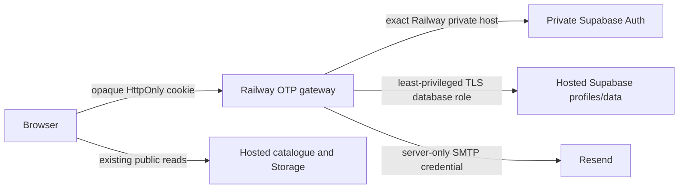

> Superseded on 11 October 2026 by [Supabase-only architecture](supabase-only-architecture.md). Retained as historical evidence; private Auth, Railway and gateway instructions are no longer an implementation plan.

# Selcore Phase 1: private Auth preparation

Prepared locally on 10 October 2026. This Phase 1 work does **not** activate OTP, deploy a Railway service, apply a migration, modify Selcore production, or alter the website. The existing source startup guard remains `false`.

It implements the first infrastructure boundary identified in [the production audit](email-otp-production-audit.md): the customer credential authority must be private and separate from Selcore's hosted Supabase Database and Storage.

## Security decision

Private Supabase Auth can be used for Selcore's customer credentials, but its JWTs must **not** be forwarded directly to the existing hosted `ffznkypurnocabqyxpps` Data API, Storage API, Realtime, or the existing profile RLS policies.

The current profiles table points to hosted `auth.users`, and its RLS helper reads hosted Auth state. A private Auth JWT has a different issuer/key set and its sessions do not exist in the hosted project's `auth.sessions`. Presenting it as though it were a hosted user token would fail or, if trust were loosened, create an unsafe identity boundary.

Supabase supports third-party JWT integrations only for configured providers that expose asymmetric OIDC keys. A standalone private GoTrue service is not a drop-in, supported replacement for hosted Auth JWTs. [Third-party Auth limitations](https://supabase.com/docs/guides/auth/third-party/overview). The recommended Phase 1 boundary is therefore:

This keeps native access and refresh tokens encrypted on the gateway. The browser never receives a private Auth token. Product catalogue/image public access remains unchanged.

## Added infrastructure

`server/otp/private-auth/` contains deliberately inactive preparation files:

- `Dockerfile` pins the official `supabase/gotrue:v2.197.0` release tag. An approved staging deployment must record and review an immutable image digest before use.
- `railway.toml` describes a separate Dockerfile-based Railway service and an internal `/health` check.
- `docker-compose.phase1.yml` is an isolated local/staging contract. It has no `ports` entry, uses an internal-only Docker network, and requires the explicit `phase1-private-auth` profile.
- `.env.example` contains variable names only.

The private Auth service contains no Resend SMTP credential. The gateway remains the sole sender: it uses `admin.generateLink` only to obtain a native proof, then sends the eight-digit code through Resend. This prevents duplicate native/gateway delivery. Direct private Auth endpoints must remain unreachable from browsers.

The configuration has these defense-in-depth settings:

| Setting                                          | Value   | Why                                                                         |
| ------------------------------------------------ | ------- | --------------------------------------------------------------------------- |
| `GOTRUE_MAILER_OTP_LENGTH`                       | `8`     | Native proof format matches Selcore OTP UI                                  |
| `GOTRUE_MAILER_OTP_EXP`                          | `600`   | Native proof expires after ten minutes                                      |
| `GOTRUE_SMTP_MAX_FREQUENCY`                      | `60s`   | Native limit matches Selcore resend cooldown                                |
| `GOTRUE_MAILER_AUTOCONFIRM`                      | `false` | Email ownership is always verified                                          |
| `GOTRUE_MAILER_ALLOW_UNVERIFIED_EMAIL_SIGN_INS`  | `false` | Unverified accounts cannot sign in                                          |
| `GOTRUE_SECURITY_REFRESH_TOKEN_ROTATION_ENABLED` | `true`  | Detects refresh-token reuse                                                 |
| Password reauthentication/current password       | `true`  | Additional native protection; it does not replace the mandatory gateway OTP |

The gateway's `SELCORE_PRIVATE_AUTH_INTERNAL_HOST` now accepts only the exact Railway private DNS name configured by an operator. It does not accept other `.railway.internal` hosts, public hosts, credentials in a URL, path prefixes, query strings, or the hosted Supabase URL.

Phase 1 adds a second source-level fail-closed guard after the existing startup guard. Even if someone incorrectly changes `serviceEnabled` to `true`, startup stops before secrets, network connections or listening because per-device trust is not yet implemented. Neither guard can be enabled through an environment variable.

## Flow readiness

The inactive gateway already prepares eight-digit codes, authoritative ten-minute expiry, five comparison attempts, and a 60-second resend cooldown for registration, login, password changes, recovery and both sides of an email change. It sends only through `smtp.resend.com` using server-only variables.

| Flow                      | Phase 1 status                                      | Required before activation                                                                                                  |
| ------------------------- | --------------------------------------------------- | --------------------------------------------------------------------------------------------------------------------------- |
| Signup                    | Gateway/native-proof contract prepared              | Private Auth raw-route adapter, app identity/profile migration and real staging test                                        |
| First login               | Gateway contract prepared                           | Device-proof schema and real private Auth test                                                                              |
| Same-device 48-hour login | **Not implemented as account-wide trust is unsafe** | Replace `selcore_otp_logins` with user-plus-device proof records; rotate handles and revoke all proofs on sensitive changes |
| Password change           | Fresh action-bound OTP contract prepared            | Private Auth mutation adapter and full PostgreSQL concurrency test                                                          |
| Password recovery         | Separate short-lived recovery contract prepared     | Raw private Auth recovery confirmation test                                                                                 |
| Email change              | Current/new-address proof contract prepared         | Confirm real native dual-token ordering and completion semantics                                                            |

The existing `native.cjs` adapter assumes a full Supabase endpoint that includes both `/auth/v1` and PostgREST. A raw GoTrue container provides Auth but not hosted PostgREST. Phase 1 deliberately does not pretend those are interchangeable. Phase 2 must replace that adapter with a tested private Auth route client and a separate hosted-data database adapter.

## Railway configuration to perform manually later

Do not perform these steps yet. They are the exact manual work required for an approved **staging** deployment:

1. Create a separate `selcore-private-auth` Railway service rooted at `/server/otp/private-auth`, using its Dockerfile. Do not assign a public domain.
2. Create a separate private Postgres service for that Auth service. It must never use the hosted Selcore database or its `auth` schema.
3. Connect Auth and its database only through Railway private networking. Record the exact `*.railway.internal` hostname and set it as both `SELCORE_PRIVATE_AUTH_INTERNAL_HOST` and the hostname of `SELCORE_PRIVATE_SUPABASE_ORIGIN` for the gateway.
4. Store values only in Railway's protected variables. Required names are `SELCORE_PRIVATE_AUTH_DB_PASSWORD`, `SELCORE_PRIVATE_AUTH_JWT_SECRET`, `SELCORE_PRIVATE_AUTH_JWT_ISSUER`, `SELCORE_PRIVATE_AUTH_EXTERNAL_URL`, and `SELCORE_GATEWAY_ORIGIN`; the gateway's names remain documented in `server/otp/.env.example`.
5. Pin the Auth image digest after reviewing the selected release's security advisories. Do not use a floating tag in staging or production.
6. Configure an exact gateway/Pages domain arrangement, explicit credentialed CORS and CSRF handling. GitHub Pages cannot serve `/api/auth` itself.
7. Verify that public Internet requests cannot reach private Auth or private Postgres. Validate `/health` only from the Railway service network.
8. Provision a dedicated hosted-application database login that has no owner, superuser, CREATE ROLE, CREATE DATABASE or BYPASSRLS capability. It must not use `service_role` for normal customer profile access.

## Remaining database and identity work

No application migration was created or changed in Phase 1. The existing pending OTP migration still references hosted `auth.users` and `auth.sessions`, so it is not eligible for deployment.

Before any staging migration, design and review an additive migration that introduces an application identity mapping, device proofs, gateway sessions and approvals without making private Auth JWTs valid in hosted RLS. It must preserve existing profile UUIDs and remove the hosted `auth.users` foreign key/trigger only as part of an explicitly staged identity cutover.

Existing passwords may be retained only after an approved, supported password-hash migration is proven with a synthetic canary. Otherwise customers require an OTP-verified password setup/reset. Do not read, log, export to Git, or manually decrypt password hashes. Existing hosted sessions, recovery grants and device trust must not migrate; customers sign in anew and complete a first-login OTP.

## Tests added

`tests/otp-phase1-boundary.test.cjs` verifies that:

- the hosted public Supabase Auth origin and sibling Railway services cannot become private Auth;
- private Auth JWT forwarding to hosted data is rejected by configuration;
- origin credential/path smuggling is rejected;
- the OTP gateway startup guard cannot be enabled by environment variables;
- staging infrastructure has no published ports or SMTP credential path;
- the Auth configuration is eight digits, ten minutes and 60 seconds; and
- templates contain no values.

These are local/static boundary tests. They do not start Docker, connect to Railway, send mail, create users, apply any migration or test real private Auth endpoints.

## Next approved step

Phase 2 should build an isolated staging-only private Auth client and application-data adapter, redesign the device/session schema, and run full PostgreSQL multi-connection tests. It requires separate approval before private services, databases, migrations, real Resend delivery, customer migration or frontend activation.
