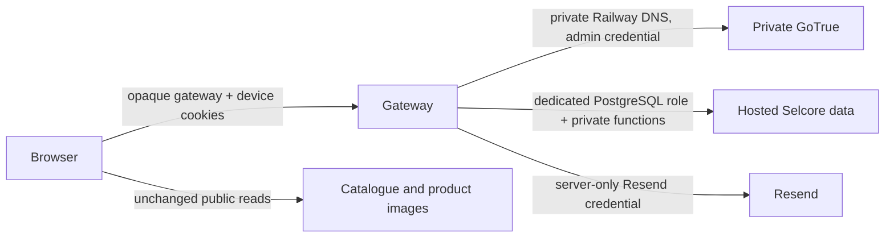

> Superseded on 11 October 2026 by [Supabase-only architecture](supabase-only-architecture.md). Retained as historical evidence; private Auth, Railway and gateway instructions are no longer an implementation plan.

# Selcore Phase 2: private Auth and hosted-data preparation

Prepared locally on 10 October 2026. This is a source-level design and test package only. It does not activate OTP, run a migration, contact production, deploy Railway, alter Supabase Auth, send an email, or change the frontend. The existing `serviceEnabled = false` guard and the Phase 1 per-device implementation guard remain enabled.

## Confirmed boundary

The new modules separate credential authority from application data:

`private-auth-adapter.cjs` uses only exact private-origin raw Auth routes. It has redirect refusal, a 15-second timeout, no browser token persistence, and no route to PostgREST, Storage, or Realtime. The underlying GoTrue service must have no public domain and must be reachable only over the exact Railway private DNS name.

`hosted-data-adapter.cjs` does not accept a JWT or a service-role key. It executes only `private.selcore_gateway_profile_read` and `private.selcore_gateway_profile_write` using a dedicated `selcore_auth_gateway` database login. Those functions map an internal identity to one pre-mapped profile UUID, so a caller cannot choose another profile. The role must be non-owner, `NOINHERIT`, `NOBYPASSRLS`, without DDL, role-management, or direct table grants. Its database password belongs only in Railway protected variables.

This is necessary because a private Auth JWT cannot safely authenticate to the existing hosted Supabase Data/Storage APIs: it has another issuer/key set and no hosted session. Allowing it to do so would break the existing RLS trust boundary. The browser must stop calling hosted Auth directly at the approved cutover, and public hosted Auth must be disabled or made unreachable for customer credential operations. A reverse proxy alone is insufficient if the public hosted Auth endpoint remains reachable.

## Pending schema redesign

`server/otp/private-auth/phase2-application-schema.sql` supersedes the data model in the older `supabase/migrations/20261010110437_selcore_email_otp_security.sql` for future review. The older migration must remain unapplied; it is unsafe for this architecture because it binds OTP records to hosted Auth identities and sessions.

The Phase 2 draft contains no references to hosted Auth tables. It introduces:

| Record                        | Purpose                                                                                                                                         |
| ----------------------------- | ----------------------------------------------------------------------------------------------------------------------------------------------- |
| `selcore_identity_map`        | Maps private Auth user IDs to existing profile IDs; no customer token controls the mapping.                                                     |
| `selcore_device_proofs`       | Stores only an HMAC digest of an opaque device token, identity-bound, revoked on sensitive events, expiring after 48 hours.                     |
| `selcore_gateway_sessions_v2` | Server-encrypted private tokens and CAS revision, indexed by an opaque gateway-cookie digest.                                                   |
| `selcore_otp_challenges_v2`   | Action-bound HMAC code digests with server-clock 10-minute expiry, five attempts, 60-second resend, preparation state and one-time consumption. |

The clear device token is delivered only as a Secure, HttpOnly, SameSite cookie on the approved gateway origin. The gateway HMACs it before storage; client fingerprints, IP addresses, local storage, and account-wide timestamps are not trust proofs. A new browser has no proof and must complete login OTP. A session refresh never extends device proof expiry.

`challenge_issue` takes an advisory transaction lock per scope. `challenge_verify` and `challenge_consume` take `FOR UPDATE` locks and consume before any Auth mutation. A fifth failed comparison locks the code. The action digest binds the exact password proposal or email-change state, and a consumed grant cannot be replayed. Credential changes, recovery, global logout and compromise handling call identity revocation, which removes device proof/session/challenge authority.

## Required staged identity cutover

Private Auth user IDs, hosted profile IDs, and private gateway sessions are different domains. Before any production migration:

1. Export only a reviewed inventory/count under a break-glass procedure; never export password hashes, refresh tokens, OTP values, or private keys.
2. In isolated staging, create private Auth identities and one identity-map row per existing profile. Preserve `profile_id` to retain profile/cart/favorites ownership. Keep the existing hosted Auth foreign key until the approved profile ownership migration is tested.
3. Decide whether the private service can use a supported password-hash import. If it cannot, require OTP-verified password reset; do not attempt to read or transform hosted password hashes.
4. Invalidate hosted sessions, recovery links and old device trust at cutover. Customers perform first-login OTP. Do not copy session state.
5. Move all credential operations through the gateway, close the public hosted Auth path for customer credential changes, and verify that no legacy SDK call remains reachable. The hosted catalogue and public image reads can stay unchanged.
6. Only after authentication cutover is proven, apply a separately reviewed profile ownership/RLS migration. Private Auth JWTs are not added to hosted RLS as a shortcut.

Hosted PostgreSQL JWT helpers and existing `profiles -> hosted auth user` relationships remain incompatible with this design until that dedicated profile migration. This is a hard staging blocker, not something these source files weaken.

## Railway and secrets for a future staging review

Required names only: `SELCORE_PRIVATE_SUPABASE_ORIGIN`, `SELCORE_PRIVATE_AUTH_INTERNAL_HOST`, `SELCORE_PRIVATE_ADMIN_KEY`, `SELCORE_OTP_HMAC_KEY`, `SELCORE_OTP_ENCRYPTION_KEY`, `SELCORE_OTP_DATABASE_URL`, `SELCORE_HOSTED_DATA_DATABASE_URL`, `SELCORE_SMTP_USER`, `SELCORE_SMTP_PASSWORD`, `SELCORE_SMTP_FROM`, and `SELCORE_GATEWAY_ORIGIN`.

Use separate Railway services for Gateway, private Auth, and private Auth Postgres. Put private Auth and both databases only on the Railway private network. Pin the GoTrue image by immutable digest after review. Configure the gateway public origin and cookie domain explicitly; GitHub Pages cannot host its `/api/auth` route. Never place these values in Git, browser JavaScript, build output, command arguments, or logs.

## Test coverage and rollback

`tests/otp-phase2-security.test.cjs` locally checks direct-hosted-origin refusal, redirect refusal, raw Auth/data boundary separation, no service-role/client-JWT interface, exact same-device 48-hour logic, password/email fresh-OTP rules, eight-digit limits, and the schema's hosted-Auth independence/locking/replay protections. It uses mocks and static SQL inspection only. It does not certify a real GoTrue version, database role, email provider, migration, or production configuration.

Before staging, add multi-connection PostgreSQL tests against the pinned database version for simultaneous issue/verify/consume, process-crash recovery, proof revocation, device-cookie rotation, and profile function ownership. Test a real private GoTrue container with synthetic users and a Resend sandbox. Run an external reachability test showing private Auth/Postgres have no public ingress.

Rollback is feature-flagged at the deployment layer, not by relaxing a database policy. Keep the source guard false until all cutover gates pass. During a staged cutover, stop new gateway traffic, revoke private sessions/device proofs, restore the verified prior frontend/gateway release, and use the preapproved data backup only for a failed additive migration. Never revive old hosted sessions or trust proofs after a security rollback.

## Remaining blockers before staging

1. Obtain an approved isolated Railway private Auth/Postgres environment and pin its image digest.
2. Prove the raw GoTrue route contract against that pinned image with synthetic credentials.
3. Provision and audit the least-privileged hosted-data login plus the profile ownership transition.
4. Design a reviewed user/password migration or OTP-reset rollout and a customer communications plan.
5. Plan how to disable direct hosted Auth calls at the approved cutover without breaking legacy callback links or Google OAuth.
6. Execute full PostgreSQL concurrency, gateway cookie/CSRF, private-network, Resend sandbox, and rollback drills.
