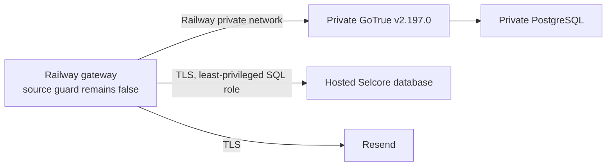

> Superseded on 11 October 2026 by [Supabase-only architecture](supabase-only-architecture.md). Retained as historical evidence; private Auth, Railway and gateway instructions are no longer an implementation plan.

# Selcore Phase 3: private authentication infrastructure and integration readiness

Prepared locally on 10 October 2026. This document and its accompanying files prepare staging work only. They do not deploy Railway services, contact the hosted Selcore project, apply a migration, send an email, create a user, enable OTP, alter frontend behavior, commit, or push. `runtime.cjs` remains source-disabled and the Phase 1 guard still stops startup before secrets, network access, or listening.

## Phase 2 audit

The private Auth/data split is the correct boundary, but Phase 2 is not deployable by itself.

| Finding                                                                                       | Resolution in Phase 3                                                                                                              | Status                                                                |
| --------------------------------------------------------------------------------------------- | ---------------------------------------------------------------------------------------------------------------------------------- | --------------------------------------------------------------------- |
| Legacy `native.cjs` assumes a full hosted Supabase origin and calls both Auth and PostgREST.  | Leave it untouched and disabled. Use `private-auth-adapter.cjs` only after a reviewed gateway rewrite.                             | Prepared; not wired.                                                  |
| A raw Auth-only container has no `/auth/v1` prefix, PostgREST, Storage, or Realtime.          | Added a versioned raw-route contract and mock contract tests.                                                                      | Verified against pinned upstream source; real-container test pending. |
| Private Auth admin operations need an actual service-role JWT, not a browser publishable key. | The adapter accepts only a server-side administrative JWT and never returns it.                                                    | Prepared.                                                             |
| Private schema functions are `SECURITY DEFINER`.                                              | Empty search paths, private schema, revoked public execution, exact gateway-role grants, and no direct table grants are required.  | Draft tested in isolated PostgreSQL.                                  |
| The old OTP migration still relies on hosted Auth identities/sessions.                        | Keep it unapplied. The Phase 2 replacement schema has its own identity/session/proof records.                                      | Hard migration-review gate.                                           |
| Hosted profile RLS still trusts hosted Auth.                                                  | A separate identity/profile ownership migration is required before cutover.                                                        | Hard production blocker.                                              |
| GoTrue version tag is reproducible but mutable.                                               | Pin the `supabase/gotrue:v2.197.0` image by immutable digest during the approved staging review.                                   | Hard staging blocker.                                                 |
| Current GitHub Pages and gateway do not have one same origin.                                 | Use a Selcore custom domain plus an `auth.` gateway subdomain with exact credentialed CORS, CSRF origin checks and secure cookies. | Architecture decision required.                                       |

The adapter contract was compared with the pinned GoTrue `v2.197.0` source: `POST /token`, `POST /verify`, `GET|PUT /user`, `POST /logout`, `POST /admin/users`, `PUT /admin/users/{uuid}`, and `POST /admin/generate_link` are present. The upstream admin-user source also accepts `password_hash`, but this does **not** prove hash compatibility with the managed hosted project. It only permits a synthetic canary in the pinned private service.

## Isolated staging topology

`server/otp/private-auth/docker-compose.phase3.yml` describes an unstarted three-service topology:

The GoTrue database and Auth service share an internal-only network. No Compose service declares `ports`. The gateway is attached to that internal network plus an egress-only network so a future approved service can reach Resend and the hosted database. The gateway Docker image deliberately runs `npm start`, which exits because the source gate is false. Use only `docker compose config` with synthetic values at this stage; do not start it with production or hosted-database credentials.

Files added for this topology are `server/otp/Dockerfile`, `server/otp/.dockerignore`, `server/otp/private-auth/docker-compose.phase3.yml`, `server/otp/private-auth/phase3.env.example`, and `server/otp/private-auth/gotrue-v2.197.0-contract.json`. The Docker ignore rules exclude local `.env` files and dependency directories.

## Railway configuration and deployment order

Do not perform these steps yet.

1. Create isolated **staging** Railway services: private Postgres, private GoTrue, and gateway. Give GoTrue and private Postgres no public domain. Record the exact private DNS name and use it for both `SELCORE_PRIVATE_SUPABASE_ORIGIN` and `SELCORE_PRIVATE_AUTH_INTERNAL_HOST`.
2. Pin the GoTrue image digest corresponding to reviewed `v2.197.0`. Verify the private `/health` endpoint only from the Railway private network.
3. Create an admin JWT with the configured `service_role`, signed only for the private GoTrue issuer. Store it as `SELCORE_PRIVATE_ADMIN_KEY` in protected Railway variables. It is not the hosted Supabase service role and never enters a browser, Git, logs, or command line.
4. Provision the hosted-data login using the Phase 3 role draft **only in staging**. Set its password out of band in the secret manager. Apply the Phase 2 private schema only after role creation, because it grants the two exact profile functions to that role.
5. Prove private GoTrue route compatibility with synthetic users, a synthetic password-hash import canary, and a dedicated Resend sandbox sender/recipient. Confirm no public request can reach private GoTrue or private Postgres.
6. Run the dedicated profile ownership migration and all identity/session cutover drills in staging. Keep `serviceEnabled = false` until an explicit activation review.
7. Only after those gates, deploy the gateway and frontend cutover together, then retire old hosted-data authorization. Production migration/Auth configuration requires separate approval.

Required variable names are listed in `server/otp/private-auth/phase3.env.example`; values are intentionally absent. The key groups are private Auth DB/JWT/admin credentials, gateway HMAC/encryption keys, hosted-data database connection, Resend SMTP credentials, exact gateway origin and sandbox-only SMTP probe controls.

## Hosted-data least privilege

`phase3-hosted-data-role.sql` creates a single non-owner, non-superuser, `NOBYPASSRLS`, `NOINHERIT` login role. It has no direct table, sequence, Storage, catalogue, Auth, DDL, role-management, or service-role access. The Phase 2 schema grants it `EXECUTE` on only:

- `private.selcore_gateway_profile_read(uuid)`
- `private.selcore_gateway_profile_write(uuid, text)`

Those functions map a private identity to one mapped profile UUID. The browser cannot choose a profile UUID, and private Auth JWTs are never presented to the hosted Data API. The migration owner must be a separate reviewed role; it owns `SECURITY DEFINER` functions, while the runtime login owns nothing.

## Identity, password and session migration

Use immutable mappings: private GoTrue user ID -> `selcore_identity_map.identity_id` -> existing `profiles.id`. A staged proof may retain UUIDs only if every current hosted Auth UUID passes the pinned GoTrue UUID validation. Do not assume that without a synthetic inventory check.

Password handling has two mutually exclusive paths:

1. **Preferred safe fallback:** create private identities without reusable password material and require an OTP-verified password setup/reset at first private login.
2. **Only if proven in staging:** import a synthetic bcrypt-compatible hash through the pinned GoTrue admin endpoint, then prove login. Do not export, print, transform, or store real managed password hashes until legal/security approval and a documented break-glass procedure exist.

Existing hosted access/refresh tokens, gateway cookies, recovery links, email-change links and device proofs must be invalidated. They are not migrated. A customer completes first-login OTP in the new gateway. Password changes, recovery, email changes and global logout revoke the private identity’s device proofs, sessions and unconsumed challenges.

## Frontend and hosted-Auth cutover

At the approved release, replace each direct SDK credential call in the browser with narrowly defined gateway endpoints:

| Existing browser action         | Gateway flow                                                                         |
| ------------------------------- | ------------------------------------------------------------------------------------ |
| Sign up / resend / confirmation | registration challenge, Resend code, consumed creation/confirmation grant            |
| Password sign-in                | private GoTrue password check, then first-login or same-device OTP decision          |
| Password recovery               | generic recovery request, challenge, single-use password-set grant                   |
| Password change                 | fresh action-bound OTP, consume before private admin update, revoke sessions/proofs  |
| Email change                    | old-address OTP then new-address OTP, consume both before private admin update       |
| Logout                          | delete gateway session, revoke private GoTrue session, revoke device proof if global |

The browser receives only opaque Secure/HttpOnly cookies issued by the gateway. It does not receive private access, refresh, admin, OTP or hosted service-role tokens. A custom Selcore domain is required so the Pages application and gateway can use a reviewed same-site cookie design. An exact Pages origin may be allowed through credentialed CORS only after CSRF tests; wildcard origins and permissive CORS are prohibited.

Direct hosted Auth is prevented as a meaningful bypass only after all three conditions hold:

1. no released frontend or callback route invokes hosted credential endpoints;
2. hosted profile/data RLS no longer treats a hosted Auth token as customer authority; and
3. hosted legacy sessions and eligibility are invalidated during the cutover.

Hosted Supabase Auth itself may remain publicly reachable; network restrictions do not cover its HTTPS API. Therefore hiding a key, CORS, or a reverse proxy is not a sufficient control. Before the three conditions, mandatory OTP cannot be claimed.

## Resend and end-to-end readiness

`resend-sandbox.cjs` has an explicit two-step guard. It returns no delivery plan unless `SELCORE_SMTP_TEST_ENABLED=approved_sandbox`, and it still refuses to send unless `SELCORE_SMTP_TEST_SEND=approved` and a dedicated sandbox recipient is supplied. No probe was sent in this phase. Use a non-production Resend credential, sender and recipient only after separate authorization.

The test suite covers contract/order readiness for registration, first and later same-device login, recovery, password change, both email-change proofs, Resend sandbox guards, direct-hosted-origin refusal, refresh/replay concurrency, expired/revoked/cross-account device proof, and private-function access denial. It is not a live end-to-end certification: GoTrue, Railway, Resend and hosted data are mocked or isolated locally.

## Rollback and remaining blockers

Rollback is an operational release rollback, never a relaxation of OTP/RLS. Stop gateway traffic, revoke private sessions/device proofs, restore the verified prior frontend and gateway release, and restore only an approved additive-migration backup if needed. Do not restore hosted sessions or old trust proofs.

Blocking before staging:

1. Approved Railway staging services, a GoTrue image digest, private ingress verification and backup ownership.
2. An exact custom-domain/cookie/CORS/CSRF arrangement for GitHub Pages and Railway.
3. A synthetic real-container GoTrue contract test, including admin JWT semantics and password-hash canary.
4. A dedicated non-production Resend sandbox credential/sender/recipient and delivery test.
5. A reviewed identity/profile ownership migration that removes hosted Auth as the protected-data authority.
6. An approved customer reset/migration, legacy callback, Google OAuth and customer-support plan.
7. A full staging failure/rollback rehearsal and separate approval before any production configuration, migration, OTP activation or deployment.
