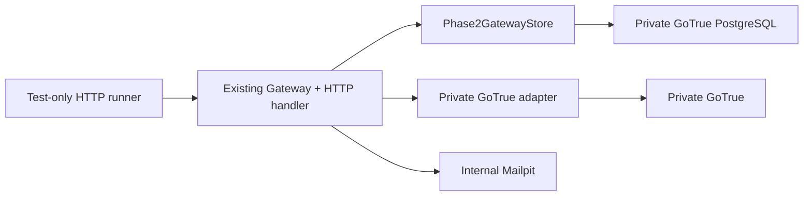

> Superseded on 11 October 2026 by [Supabase-only architecture](supabase-only-architecture.md). Retained as historical evidence; private Auth, Railway and gateway instructions are no longer an implementation plan.

# Selcore Phase 5A: Private Authentication Gateway Integration Repair

Prepared 11 October 2026. This work changes only local, uncommitted Selcore
source and test artifacts. It did not start a Phase 5 Docker stack, contact
production Supabase or Railway, apply any migration, send email, use customer
data, modify frontend authentication, commit, push, deploy, or access iVenue.

## Legacy dependency audit

The prior HTTP gateway had two incompatible dependency groups:

| Component | Legacy dependency | Phase 5A repair |
| --- | --- | --- |
| `gateway.cjs` / `http.cjs` | `Store` functions named `private.selcore_otp_*` and an account-wide login timestamp | Added device-binding support behind an explicit `deviceBoundApprovals` option. The production default remains unchanged. |
| `native.cjs` | Supabase JS client pointed at a private-looking URL but still includes hosted profile Data API behavior | Added `private-native-adapter.cjs`, a GoTrue-only compatibility layer over `private-auth-adapter.cjs`. It has no hosted Data, Storage, or public Supabase origin. |
| `store.cjs` | Historical hosted-Auth OTP schema contract | Added `Phase2GatewayStore`, which calls only `private.selcore_phase2_gateway_*` functions. |
| Phase 2 SQL draft | Hosted profile functions were mixed with private Auth state and the gateway role was only an incomplete assumption | Added a private-GoTrue-only schema with a non-owner function-execution role, private `auth.users` / `auth.sessions` references, no hosted `public.profiles`, RLS, function-only privileges, advisory-lock issuance, row-lock verification, compare-and-swap sessions, and binding-scoped 48-hour device proofs. |
| SMTP | Production Resend-only sender | Added `mailpit-isolated.cjs`, which accepts only Docker host `mailpit`, port 1025, `example.invalid` senders and recipients, and eight-digit codes. It is never imported by `serve.cjs`. |

## Integration shape

The production entry point does not import this path. The isolated factory
requires both `NODE_ENV=test` and `SELCORE_ISOLATED_AUTH_TEST=true`, and it
requires injected database and mail adapters. It cannot use a hosted Supabase
origin because the underlying private-origin validation remains in force.

## Security properties prepared

- Registration, login, recovery, password, and email code challenges retain
  eight ASCII digits, ten-minute expiry, five comparisons, and 60-second
  shared-scope cooldown.
- Verification and action consumption lock the challenge row. Only a verified,
  unconsumed row with its exact browser binding, purpose, and action digest can
  be consumed.
- A successful login OTP records trust by private user ID **and opaque browser
  binding** for at most 48 hours. A second browser binding therefore receives
  no exemption.
- Password/recovery/email operations never use the login-device exemption.
  Password and recovery revoke user device proofs and approvals.
- Gateway session state is encrypted in application code and saved with a
  revision compare-and-swap function.
- The private database has no hosted profile functions, direct customer grants,
  or Data API requirement. Hosted profile authorization remains a later,
  separate adapter and migration task.

## Test results

| Test | Result | Boundary |
| --- | ---: | --- |
| `otp-phase5a-integration.test.cjs` | 15 passed | Adapter/schema/Mailpit unit tests with mocked private GoTrue HTTP |
| `otp-security.test.cjs` | 91 passed | Isolated PostgreSQL/crypto/loopback HTTP; Auth and SMTP mocked |
| `otp-startup.test.cjs` | 24 passed | Real child-process refusal and network/DB/SMTP/listen tripwires |
| `otp-phase2-security.test.cjs` | 26 passed | Local adapter/schema security checks |

No failures occurred. These results do **not** establish a real GoTrue,
Mailpit, cookie, or gateway HTTP integration.

## Remaining blockers before Docker staging

1. Run the corrected schema only in a fresh private GoTrue PostgreSQL database.
   Provision a separate `LOGIN` database principal that is a member of the
   non-login `selcore_auth_gateway` role; provide its password only through a
   local ignored environment file. Do not connect the gateway as database owner.
2. Add a test-only Compose profile for Mailpit, database schema initialization,
   private GoTrue's internal DNS alias, the isolated gateway process, and a
   synthetic HTTP test runner. Neither GoTrue nor PostgreSQL may publish a
   public port; only a loopback test gateway may be exposed when necessary.
3. Execute real container tests for all six credential flows, captured emails,
   expiry/attempt/cooldown/replay/concurrency cases, cookies/CSRF, JWT refresh
   and revocation, and direct GoTrue reachability from the runner and host.
4. Verify GoTrue's pinned v2.197.0 behavior for dual email-change links and
   global session revocation. The adapter contract is currently mocked for
   those routes.
5. Before any future production consideration, replace the browser's direct
   hosted Supabase Auth calls, provision the separate least-privileged hosted
   profile role, migrate identities, invalidate legacy hosted sessions, and
   review JWT/RLS compatibility. Until then, hosted Auth remains a bypass for
   the requested mandatory OTP policy.

## Readiness

Phase 5A is **ready for a fresh, isolated Docker integration run only after**
the reviewed Compose harness in item 2 is added. It is not ready for Railway,
production Supabase, frontend cutover, or customer testing.
